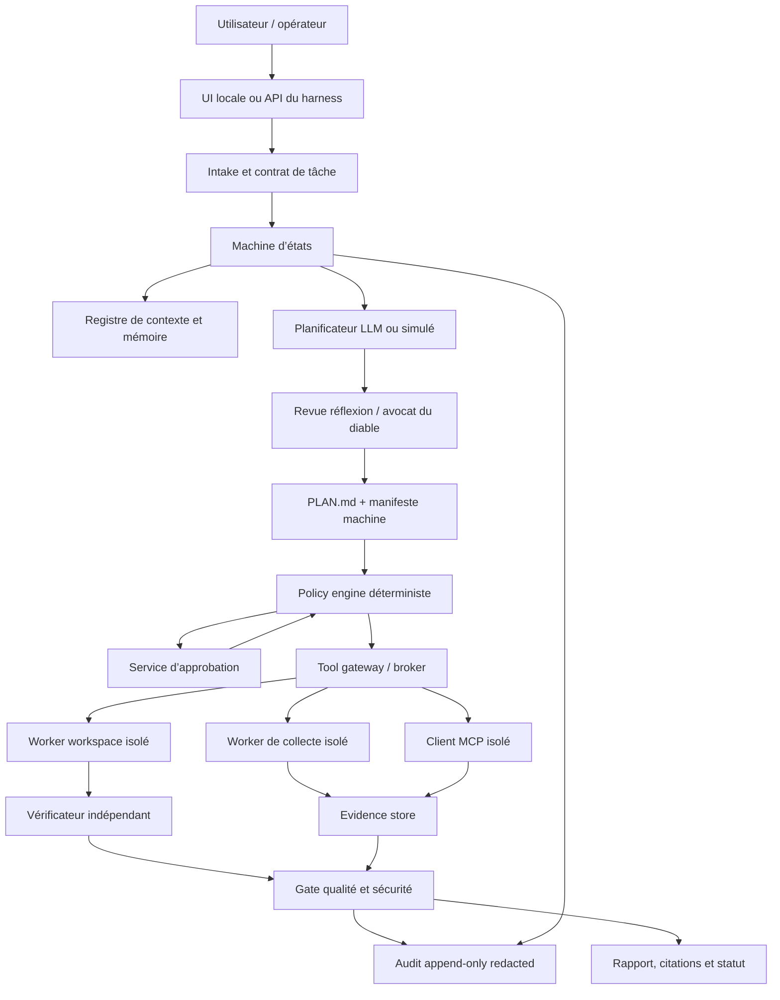

# Blueprint d’architecture — Harness agentique local-first

## Sélection raisonnée, décision d’architecture et périmètre de confiance

Le système à construire est un **harness agentique** : il encadre un ou plusieurs modèles, les sources de contexte, les outils et l’environnement d’exécution. Il ne doit pas être confondu avec un assistant conversationnel, un protocole d’outils, un LLM, une skill Markdown ou un crawler. L’Assistant NXUS public est attesté comme une interface de questions sur les formations, le financement, l’inscription et le développement professionnel, avec un avertissement explicite sur les erreurs possibles ; les sources publiques consultées n’attestent pas qu’il dispose d’un terminal, d’un CRM, d’une mémoire persistante ou d’une autonomie d’action. Il sert donc de référence de périmètre conversationnel prudent, et non de dépendance ou de modèle à cloner. [1]

Le blueprint réutilise uniquement des **pratiques publiquement documentées** : cycle analyse–plan–exécution–vérification, artefacts de preuve, skill discovery, RAG cité, validation humaine et isolation. Le guide NXUS décrit cette boucle comme un pattern général de travail agentique, pas comme une implémentation de l’Assistant public. [2] Les playbooks Rudy sont également des instructions Markdown publiques : leur attribution indique que les chemins, secrets, identifiants, détails de serveurs, hypothèses propres à des projets et données clients de workflows privés ont été retirés. [11] Aucun code privé, prompt privé, système interne ou intégration non attestée ne fait donc partie de ce plan.

### Arbitrages de contradictions et homonymies

| Sujet ambigu | Décision retenue dans ce blueprint | Justification documentée |
|---|---|---|
| **NXUS / nxusKit** | Ne pas intégrer `nxusKit` ni l’attribuer à nxus.fr sans évaluation séparée. | Les rapports ne documentent aucune relation technique attestée ; seules les pratiques éditoriales publiques de Nxus sont reprises. [1] [2] |
| **Skills NXUS, Superpowers et Rudy** | Les considérer comme des **références méthodologiques** ou des paquets à auditer, jamais comme des contrôles d’exécution. | Le format Agent Skills organise des instructions et ressources ; les skills n’accordent pas de capacités par elles-mêmes. [5] [6] [11] |
| **Rudy `deepsec-security-gate` / Vercel DeepSec** | Intégrer le premier comme matrice de revue et garder le second comme adaptateur séparé, facultatif et évalué. | Rudy déclare explicitement ne pas inclure le scanner, les matchers ou du contenu propriétaire de Vercel DeepSec. [11] |
| **Scrapling** | Seul `D4Vinci/Scrapling` peut être évalué comme extracteur Python moderne ; `kernelmethod/scrapling` reste un crawler Go minimal distinct. | Les dépôts ont des langages, licences et fonctionnalités différents ; le dépôt Go se présente comme un simple crawler léger. [25] [26] |
| **« local-first »** | Désigne un défaut d’exécution et de stockage local, non une promesse d’absence totale de sortie réseau. | Ollama, Open WebUI et AnythingLLM peuvent être utilisés localement, mais les fournisseurs, outils Web, MCP, indexeurs, mises à jour et connecteurs activés introduisent des flux à gouverner. [17] [19] [20] [21] |
| **MCP** | Est un protocole d’adaptation ; il ne porte ni la politique métier, ni le consentement effectif, ni le sandboxing. | La spécification MCP définit la connexion hôte–client–serveur et précise que les implémentations doivent construire consentement, contrôles d’accès et protections de données. [22] |

## Principes de sécurité et limites d’autorité

Le modèle est un composant de **proposition et de synthèse**. Il ne détient aucune autorité propre, ne choisit pas ses permissions, ne lit pas directement les secrets et ne déclenche pas d’effet externe par un texte, un `tool_call`, une instruction de skill ou un résultat de recherche. La recommandation suit le principe OWASP selon lequel l’autorisation doit être vérifiée hors contexte du modèle et selon l’acteur, l’outil, la ressource et les paramètres. [14]

### Invariants non négociables

1. **Refus par défaut.** Une session démarre sans outil d’écriture, sans réseau sortant, sans secret, sans accès à la production et sans accès à l’identité d’un utilisateur. Une capacité est ajoutée seulement si le contrat de tâche, la politique, le manifeste approuvé et l’environnement l’autorisent tous.
2. **Séparation des canaux.** Les politiques du harness, le contrat utilisateur, les données récupérées, les sorties d’outils, les prompts distants et la mémoire dérivée sont stockés et injectés dans des compartiments distincts. Une page, un e-mail, un document, un résultat d’API ou un dépôt analysé est une **donnée non fiable**, même lorsqu’il paraît donner une instruction. Cette séparation répond en particulier aux risques d’injection directe, indirecte, RAG et manipulation d’outils décrits par OWASP. [15]
3. **Identité et moindre privilège.** Chaque worker, connecteur et environnement possède une identité de service distincte. Les secrets sont résolus à l’exécution par un broker et ne doivent ni apparaître dans les prompts, ni dans les manifests, ni dans les logs, ni dans les artefacts remis à l’utilisateur. Un coffre réduit la diffusion d’un secret, mais ne rend pas ce secret invisible à un processus auquel il a été accordé : le broker doit donc préférer des jetons courts et scopés.
4. **Autorisation au point d’effet.** Les opérations `send`, `publish`, `deploy`, `push`, `delete`, `pay`, `rotate`, `migrate`, modification de DNS ou écriture dans un système métier requièrent un outil spécialisé, une approbation explicite et une nouvelle vérification juste avant l’appel. Les demandes doivent afficher cible, paramètres normalisés, coût, données sortantes, effet, réversibilité et rollback. Le principe de consentement explicite et d’affichage clair des outils est également demandé par MCP pour les opérations sur outils. [22]
5. **Approbation exacte, courte et consommable.** Un grant d’approbation est lié à `actor_id`, `run_id`, `manifest_hash`, `tool_id`, arguments normalisés, ressource, risque, date d’expiration et nonce. Le gateway le consomme atomiquement ; toute variation de paramètres, de ressource ou de manifeste invalide le grant. Il ne peut pas exister d’approbation vague du type « oui pour tout ».
6. **Exécution isolée.** Toute écriture, shell, parsing de document, navigateur, MCP STDIO et traitement de code non fiable s’exécute dans un worker non-root, éphémère, avec filesystem monté au minimum, réseau refusé ou allowlisté, CPU/mémoire/disque/processus/durée bornés, et suppression des secrets à la fin. Les workers ne montent jamais le volume de contrôle du harness.
7. **Preuve indépendante.** Une affirmation de réussite ne devient pas un résultat que si un vérificateur produit une preuve adressable : test, diff, hash, code retour, état observé, capture ou résultat d’API. Les statuts `passed`, `failed`, `not_run`, `blocked` et `not_applicable` sont distincts. Le protocole de débogage Superpowers insiste sur la reproduction et le diagnostic de cause racine avant un correctif ; ce pattern est transposé en transition contrôlée, non en simple instruction de prompt. [7]
8. **Traçabilité sans exfiltration.** Les événements sont append-only, corrélés et redacted. Le journal conserve des hashes, références et métadonnées nécessaires à l’audit, mais pas les secrets, cookies, mots de passe, jetons, corps de fichiers sensibles ni raisonnement interne intégral. Les niveaux d’audit et masquages documentés pour Open WebUI illustrent la nécessité de limiter les corps capturés et de ne jamais journaliser les secrets d’authentification. [20]
9. **Arrêt sûr.** L’utilisateur et l’opérateur disposent d’un arrêt d’urgence indépendant du LLM. L’arrêt révoque les leases de worker, invalide les grants, bloque les outils ou connecteurs concernés, annule les jobs si le connecteur le permet et conserve l’état de reprise. Les erreurs de politique, d’identité, de journalisation ou de vérification critique échouent **fermées**.
10. **Aucune promesse d’expertise.** Les modes de recherche, de contradiction et de gate de sécurité sont des supports de préparation de décision. Le cas NXUS « avocat du diable » est explicitement un challenge de logique et non un avis expert ou une validation de marché. [4] Un verdict de sécurité ou un score marché reste une conclusion assistée, jamais une certification, une autorisation de déployer ou une décision métier automatique.

### Niveaux de risque et droits maximaux

| Niveau | Nature de l’opération | Exemples autorisables | Exigence minimale |
|---|---|---|---|
| **R0** | Purement local, lecture de données déjà autorisées | lecture de corpus versionné, analyse de texte, simulation | contrat de session et budget |
| **R1** | Écriture réversible dans un workspace éphémère | création de brouillon, patch dans worktree, artefact de test | manifeste approuvé, snapshot et diff |
| **R2** | Lecture réseau ou connecteur externe | récupération d’une URL allowlistée, MCP lecture seule | policy réseau, provenance, limites et audit |
| **R3** | Effet externe réversible ou exposition contrôlée | brouillon de message, création d’une PR non fusionnée, job de test | approbation nominative, dry-run/idempotence et rollback |
| **R4** | Effet financier, irréversible, de production ou sur tiers | envoi, paiement, suppression, déploiement, DNS, migration, rotation | double contrôle éventuel, approbation exacte, backup/rollback vérifié et opérateur humain |

Le **MVP n’active que R0 et une partie de R1**. R2 est simulé dans les tests ; R3 et R4 sont absents du chemin d’exécution initial. Cette décision réduit volontairement l’autonomie au lieu de chercher à reproduire les démonstrations de droits larges mentionnées dans certains playbooks. [2] [12]

## Architecture locale-first modulaire

L’architecture est organisée en deux plans. Le **plan de contrôle**, local et déterministe, conserve l’identité, la politique, les états, les approbations et l’audit. Le **plan de données/exécution** reçoit uniquement les inputs nécessaires à une tâche, produit des résultats isolés et ne peut pas modifier le plan de contrôle directement.



### 1. Intake et contrat de tâche

`TaskContract` est la seule entrée qui peut faire naître une exécution. Il comprend :

- identifiant de tâche et de tenant/workspace ;
- objectif et critère d’acceptation observable ;
- périmètre et hors-périmètre ;
- classification des données et finalité ;
- budget de durée, tours, tokens, coût et appels ;
- niveau maximal de risque ;
- ressources, outils et connecteurs sollicités ;
- approbations requises, rollback et critères d’arrêt ;
- source de la demande et champs explicitement inconnus.

Ce contrat reprend la discipline de preflight de la boucle Rudy, qui demande objectif, succès vérifiable, périmètre, budget, risques et vérifications avant action. [12] Dans le harness, ce sont toutefois des champs validés par schéma et signés/versionnés, pas une section de prompt libre.

L’intake classe immédiatement la tâche dans l’un des profils : `QA_READONLY`, `DECISION_CHALLENGE`, `RESEARCH_READONLY`, `CODE_CHANGE`, `SECURITY_REVIEW`, ou `EXTERNAL_ACTION`. Un profil détermine les états permis, le budget, les outils visibles et les preuves attendues. Une demande ambiguë, hors périmètre, trop sensible ou sans critère vérifiable passe en `NEEDS_CLARIFICATION` et ne reçoit aucun outil.

### 2. Machine d’états persistante

Le contrôleur applique les transitions suivantes :

```text
INTAKE
  → CLARIFYING | DISCOVERY | ABORTED
DISCOVERY
  → DRAFTING_PLAN | ABORTED
DRAFTING_PLAN
  → REFLECTION_REVIEW | AWAITING_APPROVAL | ABORTED
REFLECTION_REVIEW
  → DRAFTING_PLAN | AWAITING_APPROVAL | ABORTED
AWAITING_APPROVAL
  → APPROVED | REJECTED | EXPIRED
APPROVED
  → EXECUTING | EXPIRED | ABORTED
EXECUTING
  → VERIFYING | BLOCKED | ABORTED
VERIFYING
  → SECURITY_GATE | COMPLETED_WITH_LIMITS | FAILED | ABORTED
SECURITY_GATE
  → COMPLETED | COMPLETED_WITH_RESERVATIONS | FAILED | ABORTED
```

Le pattern `DRAFTING → AWAITING_APPROVAL → EXECUTING → VERIFYING` dérive du mode réflexion avant action publié par Nxus ; le blueprint le renforce avec un manifeste machine, une policy indépendante et une vérification post-action. [3] Les transitions sont effectuées par le contrôleur transactionnel, jamais par le LLM. Toute modification du manifeste, des outils, des ressources, du budget ou du niveau de risque révoque l’approbation et retourne à `AWAITING_APPROVAL`.

### 3. Plan, réflexion et avocat du diable

Le planificateur ne peut créer que deux artefacts :

- `PLAN.md`, lisible par l’humain : contexte, options, hypothèses, fichiers/ressources, risques, alternatives, tests et rollback ;
- `plan.manifest.json`, lisible par machine : hashes de base, opérations autorisées, outils, arguments ou contraintes d’arguments, chemins, hôtes, limites, tests, risques, échéance et hash du plan humain.

Le hard gate de brainstorming Superpowers, qui interdit construction, scaffolding et installation avant l’approbation du design, inspire deux gates séparés : **approbation du design**, puis **approbation du plan d’exécution**. [6] Cette séparation évite qu’un accord sur une intention soit interprété comme un accord sur des commandes, un transfert de données ou un déploiement.

La revue `reflection` cherche les écarts entre contrat et plan : permissions non justifiées, ressources non autorisées, critères absents, absence de rollback, dépendances non épinglées, donnée sensible sans finalité ou test insuffisant. Elle est déterministe lorsque la règle existe et peut être enrichie d’un second modèle en lecture seule ; le second modèle ne possède aucun outil d’écriture.

La revue `devil_advocate` est limitée à l’aide à la décision. Elle exige une reformulation confirmée, puis sépare **faits fournis**, **hypothèses**, **inférences**, **objections**, **preuves nécessaires** et **questions actionnables**. Elle ne produit pas de verdict d’entreprise automatique. Cette structure maintient la limite exposée par le cas NXUS de contradiction assistée. [4]

### 4. Policy engine et service d’approbation

Le `PolicyEngine` reçoit une demande normalisée, jamais une phrase brute. Sa décision est purement déterministe :

```text
allow | require_approval | deny | require_clarification | block_and_escalate
```

Il évalue au minimum : identité, tenant, profil de tâche, état, risque, hash de manifeste, outil et version, action, ressource, classification des données, hôte/chemin, budget, vérifications préalables, approbation et kill switch. Son résultat inclut une règle, une version de politique et une justification auditée.

Le `ApprovalService` montre un résumé non ambigu : action, cibles, paramètres, données envoyées, coût maximal, changement attendu, test préalable, rollback, expiration. La validation crée un `ApprovalGrant` non rejouable. Le gateway revalide le grant juste avant l’effet. Cette défense traduit le principe OWASP de liaison entre autorisation, identité, outil, ressource, paramètres et expiration. [14]

### 5. Registre d’outils et tool gateway

Le registre est une base versionnée ; aucune découverte dynamique ne suffit à y ajouter un outil. Chaque `ToolDefinition` possède :

```text
tool_id, version, owner, provenance, digest, licence,
kind, transport, input_schema, output_schema,
risk_level, read_or_write, idempotency, dry_run,
allowed_resources, network_policy, secret_policy,
timeout, retry_policy, concurrency_limit,
verification_contract, rollback_contract, approval_policy,
health_status, review_date, status
```

Le modèle voit uniquement la projection du registre autorisée par le run : nom stable, description courte, schéma, coûts et limites. Il ne voit ni les identifiants, ni les outils R3/R4, ni les capacités cachées d’un serveur. Toute invocation traverse : validation JSON Schema, normalisation, décision de policy, contrôle de grant, plafond de coût/durée/concurrence, exécution isolée, validation de sortie, redaction, preuve et audit.

MCP devient un **transport derrière ce gateway**. La spécification sépare bien `tools`, `resources` et `prompts` et avertit que les descriptions et annotations d’outils doivent être considérées non fiables hors serveur de confiance. [22] Le broker MCP maintient donc un client et une identité par serveur, une allowlist de primitives et un cache borné de découverte. Pour les serveurs locaux, il privilégie STDIO dans un sandbox ; pour les serveurs HTTP, il exige egress allowlisté, TLS et tokens liés au serveur et à l’audience. Le flux OAuth MCP documente notamment PKCE, `resource` et validation d’audience ; aucun token n’est relayé à un autre serveur. [23]

### 6. Workers et vérification

Le `WorkspaceRunner` reçoit un snapshot de dépôt ou un répertoire temporaire, pas le home de l’opérateur. R1 autorise seulement des opérations déclaratives comme créer un brouillon ou appliquer un patch à des chemins allowlistés. Aucun shell arbitraire ne fait partie du MVP. Une extension future peut ajouter des commandes prédéfinies et versionnées (`test`, `lint`, `build`) à condition que leur répertoire, leur timeout, leurs variables exposées, leur réseau et leurs sorties soient contrôlés.

Le `Verifier` s’exécute dans un contexte distinct du planificateur. Il compare : commit/snapshot initial, manifest approuvé, diff réel, fichiers touchés, changements de dépendances, commandes réellement exécutées, appels réseau, tests, résultats et artefacts. Il ne peut pas déclarer `passed` en cas de test absent : ce cas est `not_run` ou `blocked`. Le protocole de débogage systématique contribue les concepts de reproduction avant/après, hypothèse unique, patch minimal et escalade après échecs significatifs. [7]

Le `SecurityGate` consomme une matrice à preuves. La checklist Rudy couvre notamment secrets, contrôles serveur d’authentification et de rôles, ownership, validation, webhooks, uploads, IA, dépendances et rollback ; elle est utile comme référentiel mais n’est pas un scanner ni une certification. [13] Le blueprint mappe les contrôles applicables à des états `pass`, `fail`, `unknown`, `not_run` ou `not_applicable`, avec preuve, propriétaire et échéance. Un `FAIL` ou une preuve critique manquante bloque toute promotion. La matrice peut s’aligner progressivement sur OWASP ASVS et les catégories API/GenAI, sans prétendre que cette conformité est automatiquement démontrée. [16]

### 7. Audit et observabilité

`AuditEvent` est append-only et contient : `event_id`, timestamp, run, tenant, actor, composant, version de politique, hash de manifeste, phase, décision, outil, paramètres redacted ou hashés, ressource, coût, résultat, hashes d’artefacts, erreurs et référence à l’approbation. Une chaîne de hash par segment de journal rend toute modification postérieure détectable ; une rétention réglable et une clé de signature d’opérateur renforcent l’intégrité sans promettre une immutabilité matérielle.

Les métriques minimales sont : taux de refus, approbations expirées, appels par outil, erreurs de policy, contenu suspect isolé, test pass/fail/not-run, déviations plan/réalité, coût, latence, saturation de workers et taux de citations vérifiables. Les logs de diagnostic sont minimisés et redacted ; les événements de sécurité n’embarquent pas le contenu sensible responsable de l’alerte.

## Mémoire, provenance, citations et qualité des réponses

La mémoire est segmentée par tenant, workspace, classification et durée de rétention. Elle ne doit pas être un historique global que le modèle peut enrichir librement. AnythingLLM illustre l’utilité du workspace comme unité de portée pour conversations et documents ; sa documentation distingue aussi documents attachés au thread et documents embarqués au workspace. [30] Le harness reprend cette notion, mais garde l’autorité d’ACL et de rétention dans son propre control plane.

| Store | Contenu | Écriture | Règle de confiance |
|---|---|---|---|
| **Policy store** | règles, registres, clés publiques, configurations approuvées | administrateur via changement revu | source de contrôle uniquement |
| **Source store** | documents d’origine, URL, hash, licence, date, statut d’ingestion | collecteur approuvé | donnée externe non fiable mais traçable |
| **Evidence store** | extrait exact, locator, `source_id`, hash, langue, date de récupération | pipeline de collecte | preuve citée, pas instruction |
| **Claim store** | affirmation atomique, type, criticité, `evidence_ids`, statut | rédacteur/vérificateur | assertion à contrôler |
| **Session store** | conversation, plan, approbations, état | contrôleur | isolé par run/tenant |
| **Derived memory** | résumé, préférence validée, index de graphe | service explicitement autorisé | réversible, TTL, marqué dérivé |

Le modèle claim–evidence–source est adopté du Deep Research Skill : une affirmation doit pointer vers une évidence, qui pointe vers une source. Le dépôt public sépare ces objets et son script d’orchestration se décrit explicitement comme un « state scaffold », non comme un runtime d’orchestration ; le harness fournit donc le contrôleur manquant. [8] [9]

Pour chaque réponse factuelle, le rédacteur ne peut citer que des `evidence_id` validés. L’interface affiche au minimum : titre, URL, date de collecte, extrait/locator, date source lorsqu’elle est connue, statut (`supported`, `partial`, `conflicted`, `unsupported`, `needs_review`) et différence entre fait source, synthèse et recommandation. Une citation présente mais non résolue bloque un claim factuel critique. Trois sources ne valent pas automatiquement triangulation : le contrôleur détecte les URL canoniques identiques, versions republiées, dates incompatibles et dépendances à une même source primaire.

L’ingestion suit le pipeline ci-dessous :

```text
cible autorisée → fetch minimal → normalisation → hash/provenance
→ quarantaine du contenu → extraction d’évidence ciblée
→ contrôle de taille/type/PII → index local versionné
→ retrieval filtré par ACL → réponse citée
```

Le RAG est un optimiseur de contexte, non une autorité. Ollama expose des embeddings et recommande d’employer le même modèle à l’indexation et à la requête ; le harness consigne donc modèle, digest ou tag, segmentation, taille de chunk, paramètres et version de l’index. [29] Le test de qualité RAG mesure rappel, précision, fraîcheur, contradiction, fuite inter-tenant, injection indirecte et citations effectivement récupérables. Une mémoire dérivée n’est jamais promue en source primaire sans ré-ingestion et revue.

Les graphes de code peuvent être ajoutés par adaptateur. Understand Anything distingue les faits structurels extraits via Tree-sitter des résumés/couches produits par LLM et écrit un graphe JSON versionnable ; cette séparation est utile pour distinguer fait déterministe et interprétation. [10] Un graphe importé, un résumé ou une estimation de blast radius ne peut toutefois jamais autoriser seul une action.

## Boucle planifier–agir–vérifier par profil de tâche

### Questions/réponses en lecture seule

`QA_READONLY` ne dispose que du corpus local déjà autorisé et du retrieval. La réponse doit être citée ou indiquer clairement que le corpus ne couvre pas la question. Le premier cas d’usage est une Q/R bornée au corpus Nxus public, conformément au périmètre attesté de l’Assistant NXUS. [1]

### Recherche documentaire bornée

`RESEARCH_READONLY` ajoute, après policy, un collecteur R2 à domaines allowlistés. Le plan définit les questions, les types de sources recherchées, les limites de profondeur et le budget. La boucle est `retrieve → evidence store → claim verification → delta retrieve si lacune`, avec sorties Markdown d’abord et autres formats seulement dans un worker de packaging isolé. Cette boucle reprend la méthode documentée du Deep Research Skill sans importer son orchestration comme dépendance. [8] [9]

### Préparation de décision

`DECISION_CHALLENGE` reste sans outil par défaut. Il exécute exposition, reformulation confirmée, objections catégorisées, questions actionnables, réponse humaine et synthèse sans verdict automatique. Les sources de recherche, si activées, demeurent lecture seule et apparaissent comme preuves distinctes des objections. Cette limite respecte le cas NXUS de contradicteur conversationnel. [4]

### Changement de code local

`CODE_CHANGE` ouvre un worktree/snapshot R1, sans réseau. Après design et plan approuvés, il applique des patchs limités aux chemins du manifeste, exécute uniquement les vérificateurs déclarés et compare le diff. En cas de trois hypothèses significatives échouées ou de divergence du périmètre, le contrôleur suspend les mutations et crée un événement d’escalade ; « trois » est une heuristique de sécurité opérationnelle, non une loi de convergence. [7] [12]

### Action externe (hors MVP)

`EXTERNAL_ACTION` n’est activable qu’après intégration d’un outil spécialisé R3/R4 et d’un runbook de rollback. Il requiert au minimum dry-run lorsque possible, action idempotente, approbation courte, identités séparées, journal, vérification du résultat réel et chemin de reprise humaine. Les actions de paiement, communication, suppression, production ou DNS restent sur cette voie séparée, comme le demandent les lignes rouges documentées par les playbooks Rudy. [12] [13]

## Profils d’exécution : simulation d’abord, connecteurs ensuite

Aucune brique externe n’est obligatoire. Le noyau fonctionne avec un planificateur simulé, un corpus de fixtures, un registre local, des workers factices et des preuves déterministes. Chaque profil est déclaré dans `runtime-profile.yaml` et validé au démarrage ; une capacité annoncée mais non testée produit `UNAVAILABLE`, et non un fallback silencieux.

| Profil | Rôle et statut | Connexion possible | Garde-fous propres |
|---|---|---|---|
| **P0 — Simulated Core** | **MVP requis.** Moteur de transitions, policy, faux outils déterministes, fixtures, audit et vérificateur local. | Aucune dépendance externe. | Pas de réseau, pas de secret, pas de shell arbitraire, données synthétiques. |
| **P1 — Local Model Adapter** | Optionnel. Interface générique `chat`, `embed`, `structured_output`. | Ollama via API native locale. | Loopback, version/modèle/Modelfile épinglés, structured output validé côté harness, budgets VRAM/tokens, cloud désactivé pour charges classifiées. Ollama peut produire des `tool_calls`, mais l’application cliente exécute et réinjecte les résultats : cette exécution reste donc exclusivement celle du gateway. [17] [18] [19] |
| **P2 — Operator UX** | Optionnel. Façade de conversation et d’approbation. | Open WebUI derrière adaptateur API versionné. | Open WebUI est un control plane possible, pas la frontière d’exécution ; ses Tools/Functions exécutent du Python avec les droits du processus et doivent rester désactivés ou administrés avec revue. [20] |
| **P3 — Workspace RAG** | Optionnel. Workspaces, ingestion, retrieval et ACL documentaires. | AnythingLLM via API versionnée. | Multi-utilisateur/ACL, Developer API key confinée car elle est admin-équivalente, SQL/filesystem à privilèges minimaux, mémoire dérivée réversible. [21] |
| **P4 — External Capability Broker** | Optionnel. Contrats de services externes. | MCP STDIO sandboxé ; MCP HTTP seulement via egress contrôlé. | Serveur, version, hash, scopes et outils allowlistés ; prompts/resources distants désactivés par défaut ; OAuth avec audience stricte. [22] [23] |
| **P5 — Web Evidence Worker** | Optionnel. Collecte lecture seule et provenance. | Firecrawl, Crawlee, D4Vinci/Scrapling ou Supadata via adaptateur dédié. | URL/domaines allowlistés, robots/conditions, SSRF bloqué, budgets, navigateur éphémère, résultats non fiables et aucun formulaire mutant. [24] [25] [27] |

### Contraintes par intégration

**Ollama.** L’adaptateur utilise l’API native comme premier choix et ne suppose pas une compatibilité OpenAI complète. Les sorties JSON Schema doivent toujours être parsées et validées localement. L’instance locale doit rester liée à loopback par défaut ; une exposition réseau exige une passerelle authentifiée. Les outils appelés par un modèle ne sont jamais exécutés directement, ce que les exemples d’outil Ollama laissent explicitement au client. [17] [18] [19]

**Open WebUI.** L’intégration est une interface d’opérateur optionnelle : elle appelle l’API du harness et affiche statut, plan, preuves et approbations. Elle ne doit pas recevoir le rôle de policy engine. Son hardening indique que les Tools et Functions s’exécutent avec les mêmes droits que le processus Open WebUI ; le MVP désactive donc plugins et exécution de code, ou les maintient dans une instance de laboratoire séparée. Le mode offline ne ferme pas les connexions configurées vers fournisseurs, OAuth, recherche, tool servers ou stockage : le filtrage réseau du harness reste nécessaire. [20]

**AnythingLLM.** L’intégration est limitée à des workspaces RAG contrôlés. L’outil garde l’autorité sur les ACL, la provenance, la rétention et l’effacement complet. La politique du projet indique que le scraping interne et les URLs de services administrativement configurées sont des fonctionnalités intentionnelles, et que SQL/filesystem peuvent être activés par un administrateur ; le broker du harness doit donc les traiter comme des capacités à risque, pas comme une permission neutre. [21]

**MCP.** Les outils sont intégrés un par un à partir d’un registre. Les `resources` et `prompts` sont encore plus restrictifs : une ressource peut déclencher une fuite ou contenir une injection, tandis qu’un prompt distant ne peut pas modifier les instructions de contrôle. La spécification MCP invite explicitement les hôtes à garder le contrôle de l’utilisateur et à traiter les descriptions d’outils avec prudence. [22]

**Connecteurs Web.** Firecrawl, Crawlee, D4Vinci/Scrapling et Supadata ne sont que des fournisseurs d’acquisition. Firecrawl distingue `Scrape` d’une URL connue de `Agent` et recommande l’extraction structurée de l’URL connue plutôt que l’agent autonome lorsque c’est possible. [24] Crawlee est un moteur de crawl, non un décideur de conformité. [26] D4Vinci/Scrapling propose HTTP, navigateur, extraction adaptative et MCP, mais son adaptive scraping reste heuristique et ses capacités navigateur/proxy augmentent la surface de risque. [25] [31] Supadata fournit des jobs d’ingestion web/vidéo et des opérations asynchrones ; sa sortie d’extraction IA doit rester une donnée à valider, avec coût, `jobId`, statut et deadline journalís. [27]

## MVP de dépôt concret

Le MVP vise une démonstration testable de contrôle, non un agent autonome de production. Il s’exécute sans service réseau et n’emploie que des documents synthétiques. La stack peut être TypeScript ou Python ; le choix est secondaire tant que les contrats JSON Schema, la machine d’états et les tests restent identiques. Le dépôt recommandé est :

```text
nxus-agent-harness/
├── README.md
├── architecture-blueprint.md
├── docs/
│   ├── threat-model.md
│   ├── data-classification.md
│   ├── runbooks/
│   │   ├── approval.md
│   │   ├── rollback.md
│   │   └── incident-stop.md
│   └── adr/
├── contracts/
│   ├── task-contract.schema.json
│   ├── plan-manifest.schema.json
│   ├── tool-definition.schema.json
│   ├── approval-grant.schema.json
│   ├── evidence.schema.json
│   ├── claim.schema.json
│   ├── verification-result.schema.json
│   └── audit-event.schema.json
├── config/
│   ├── policy.yaml
│   ├── runtime-profile.simulated.yaml
│   ├── tool-registry.yaml
│   └── retention.yaml
├── src/
│   ├── intake/
│   ├── state-machine/
│   ├── policy/
│   ├── planning/
│   ├── review/
│   ├── approval/
│   ├── memory/
│   ├── evidence/
│   ├── tools/
│   │   ├── simulated/
│   │   └── gateway/
│   ├── verification/
│   ├── security-gate/
│   ├── audit/
│   └── adapters/
│       ├── model/
│       ├── ollama/        # vide ou feature-flagged au MVP
│       ├── openwebui/     # vide ou feature-flagged au MVP
│       ├── anythingllm/   # vide ou feature-flagged au MVP
│       └── mcp/           # vide ou feature-flagged au MVP
├── fixtures/
│   ├── corpus/
│   ├── adversarial/
│   ├── tools/
│   └── repositories/
├── tests/
│   ├── unit/
│   ├── contract/
│   ├── integration/
│   ├── adversarial/
│   └── golden/
├── runs/                  # ignoré par Git ; permissions restrictives
│   └── <tenant>/<run-id>/
│       ├── task.json
│       ├── PLAN.md
│       ├── plan.manifest.json
│       ├── sources.jsonl
│       ├── evidence.jsonl
│       ├── claims.jsonl
│       ├── verification.json
│       ├── security-gate.json
│       ├── report.md
│       └── audit.jsonl
└── scripts/
    ├── validate-contracts
    ├── replay-run
    └── verify-audit-chain
```

### Capabilities réellement incluses dans le MVP

1. **Contrats et validation.** Tous les objets critiques sont validés par schéma avant lecture ou écriture. Une clé inconnue dans un manifest, un outil sans propriétaire ou un grant expiré échoue fermé.
2. **Machine d’états persistante.** Les transitions sont atomiques dans un store local. Le processus redémarré reconstruit le run depuis les événements et ne reprend jamais une approbation expirée.
3. **Plan humain + manifeste machine.** Le système accepte seulement une simulation de planification ou un plan saisissable ; il permet de tester les contrôles sans dépendre d’un modèle.
4. **Registre d’outils simulés.** `read_fixture`, `write_workspace_draft`, `run_declared_check` et `retrieve_fixture` retournent des réponses prédéfinies et contrôlées. Un faux outil `send_external_message` est volontairement présent mais toujours refusé pour éprouver la politique.
5. **Evidence store et citations.** Les fixtures comportent des passages, URLs fictives ou publiques de test, dates et hashes. Le générateur de rapport refuse une citation qui ne résout pas vers une évidence valide.
6. **Vérification et gate.** Le vérificateur compare manifest/diff simulé, attache des résultats pass/fail/not-run et applique une petite matrice de contrôle : secret détecté, changement hors scope, test absent, claim critique sans evidence, approbation invalide.
7. **Audit redacted et kill switch.** Un audit en JSONL chaîné est produit pour chaque run. Le kill switch bloque les transitions exécutables et vérifie que les grants sont révoqués.

Le MVP ne comprend pas : navigateur réel, réseau sortant, clonage de dépôt, shell arbitraire, MCP réel, secret manager réel, paiement, CRM, e-mail, déploiement, DNS, stockage multi-tenant distant ni mémoire persistante non filtrée. Ces exclusions sont des résultats voulus, pas des lacunes à contourner.

## Scénarios de test et critères de sortie

Les tests sont exécutés sur fixtures, comptes de test et environnements explicitement autorisés. Ils ne doivent ni sonder des tiers, ni contourner un contrôle d’accès, ni collecter des identifiants. Le gate de sécurité Rudy a lui-même une portée défensive et réservée aux systèmes possédés ou autorisés ; le blueprint conserve cette frontière. [13]

| ID | Scénario | Résultat exigé |
|---|---|---|
| **T01** | Q/R couverte par deux passages de corpus | réponse avec citations résolues, titres, dates et `supported` ; aucun outil R1+ visible |
| **T02** | Question hors corpus ou contradictoire | abstention explicite ou statut `conflicted`, sans information inventée |
| **T03** | Document de fixture contenant une instruction hostile | contenu étiqueté non fiable ; aucun changement de policy, aucune invocation d’outil |
| **T04** | Plan qui ajoute une ressource, un hôte ou un fichier non approuvé | manifest refusé ou approbation invalidée ; événement d’audit de divergence |
| **T05** | Approbation expirée, rejouée ou associée à des paramètres modifiés | gateway refuse atomiquement l’appel ; aucune mutation simulée |
| **T06** | Demande `send` ou `delete` au MVP | refus avec explication de capacité non activée ; aucune sortie externe |
| **T07** | Faux outil avec arguments malformés ou champ supplémentaire | échec de validation de schéma avant exécution |
| **T08** | Patch simulé touchant un chemin hors manifest | `BLOCKED`, snapshot conservé, diff d’écart joint au rapport |
| **T09** | Vérification non exécutée ou code retour d’échec | résultat `not_run` ou `failed`, jamais `passed` ; promotion bloquée |
| **T10** | Claim factuel critique sans `evidence_id` valide | génération du rapport bloquée ; claim `unsupported` |
| **T11** | Journaux contenant une chaîne de secret de fixture | redaction obligatoire ; test échoue si la valeur brute apparaît dans audit, rapport ou erreur |
| **T12** | Interruption pendant `EXECUTING` | kill switch invalide grants, bloque reprise automatique et laisse un run `ABORTED` reprenable par humain |
| **T13** | Trois échecs de correction réellement distincts | passage à escalade en lecture seule ; aucune quatrième mutation automatique |
| **T14** | Deux tenants avec corpus et mémoire différents | aucun chunk, claim, audit détaillé ou approval d’un tenant ne devient récupérable par l’autre |
| **T15** | Adaptateur facultatif déclaré mais test de capacité absent | démarrage en `UNAVAILABLE`, pas de fallback vers réseau ou plugin non approuvé |

Les golden tasks mesurent aussi la couverture de citations, la conformité de schéma, le taux d’abstention correcte, la détection d’injection, le respect de budget, la redaction et la fidélité plan–réalité. Le profil NIST de gestion des risques GenAI est une référence appropriée pour structurer gouvernance, mesure et suivi, mais la présence de ce mapping ne vaut pas certification. [28]

## Qualité, revue et publication

Le processus de qualité est composé de contrôles complémentaires :

1. **Cadrage.** Une question ouverte et un playback séparent déclarations utilisateur et hypothèses. Le design contient objectifs, non-objectifs et anti-objectifs. [6]
2. **Plan et critique.** Le plan est relu par règles déterministes et, si activé, par un reviewer sans permissions. La revue avocat du diable questionne les prémisses, mais n’autorise rien. [3] [4]
3. **Exécution minimale.** Le runner applique uniquement l’opération autorisée, dans son workspace. Les modifications sont petites, diffables et réversibles.
4. **Vérification.** Les tests et contrôles sont produits séparément du texte de succès. Un test insuffisant est conservé comme limite, pas reformulé en succès. [7]
5. **Gate défensif.** Les contrôles applicables doivent avoir preuve ou statut explicite. Un `FAIL` bloque la promotion ; `PASS AVEC RÉSERVES` autorise seulement le périmètre préalablement défini, par exemple une revue interne, jamais une mise en production implicite. [13]
6. **Publication.** La sortie publique est un artefact Markdown cité, dérivé d’un rapport JSON versionné. Les HTML/PDF éventuels sont rendus dans un job non privilégié et ne deviennent jamais la source de vérité.

## Matrice d’adoption

| Brique ou pratique publique | Classement | Décision opérationnelle dans le harness |
|---|---|---|
| Contrat de tâche, discovery, plan, vérification, rapport | **Intégré dans le MVP** | Machine d’états, `TaskContract`, manifeste et preuves structurées ; inspirés de NXUS/Rudy, réimplémentés par le harness. [2] [3] [12] |
| Lecture seule par défaut, actions sensibles confirmées, isolation et audit | **Intégré dans le MVP** | Invariants de policy, registre de capacités, workers simulés, grants et kill switch. [2] [14] |
| `PLAN.md` et manifeste lié par hash | **Intégré dans le MVP** | Markdown pour la revue, JSON Schema pour l’exécution ; toute modification invalide le grant. [3] |
| Réflexion / brainstorming / builder-check | **Intégré dans le MVP** pour cadrage, **référence** pour sous-agents | Playback, hypothèses et gates design/plan ; second modèle seulement en lecture seule dans une phase ultérieure. [6] |
| Avocat du diable | **Intégré dans le MVP** | Profil sans outil, sortie structurée et aucune décision ou action automatique. [4] |
| Claim–evidence–source, JSONL et validation des citations | **Intégré dans le MVP** | Evidence store, claims atomiques, statuts de support et publication bloquée en cas de citation critique invalide. [8] [9] |
| Débogage systématique | **Intégré dans le MVP** | Reproduction, hypothèse, patch, vérification, escalade ; aucun patch sans phase de diagnostic. [7] |
| Matrice de sécurité Rudy / ASVS | **Intégré dans le MVP** à couverture réduite | États `pass/fail/not_run/unknown`, preuves et blocage ; pas de prétention de scanner ou de certification. [13] [16] |
| Agent Skills / progressive disclosure | **Référence méthodologique** | Registre de skills signé et chargement limité à la métadonnée puis au contenu approuvé ; aucune exécution automatique de scripts. [5] |
| Understand Anything / graphe Tree-sitter + LLM | **Adaptateur optionnel** | Index de code en lecture seule, épinglé et sandboxé ; faits structurels séparés des résumés LLM. [10] |
| Ollama | **Adaptateur optionnel** | Fournisseur local de modèle et d’embeddings derrière `ModelAdapter` ; aucun tool-call exécuté directement. [17] [18] |
| Open WebUI / Open Terminal | **Adaptateur optionnel** | UX opérateur et, plus tard, runtime séparé ; plugins Python in-process exclus du périmètre de confiance. [20] |
| AnythingLLM | **Adaptateur optionnel** | Workspace/RAG derrière API et ACL du harness ; pas de Developer API key exposée ni de `open-computer` de production. [21] |
| MCP | **Adaptateur optionnel** | Broker par serveur, STDIO sandboxé d’abord, HTTP/OAuth seulement après tests de contrat. [22] [23] |
| Firecrawl | **Adaptateur optionnel** | Collecte Web lecture seule, `map → sélection → scrape` et budgets ; Agent/Interact hors MVP. [24] |
| Crawlee | **Adaptateur optionnel** | Worker de crawl HTTP d’abord ; navigateur, sessions et proxy désactivés jusqu’à politique dédiée. [26] |
| D4Vinci/Scrapling | **Adaptateur optionnel** | Extraction ciblée HTTP d’abord ; adaptive, navigateur, MCP et proxy sous feature flags séparés. [25] |
| Supadata | **Adaptateur optionnel** | Ingestion vidéo/web par jobs bornés, provenance, coût et validation locale du JSON. [27] |
| Scanner Vercel DeepSec | **Référence méthodologique** puis adaptateur éventuel | Évaluation isolée seulement sur dépôts autorisés, avec budget ; ne pas le confondre avec le gate Rudy. [11] |
| Scoring SaaS/GO–TEST–NO-GO de Rudy | **Référence méthodologique** | Artefact de discussion ; aucune dépense, build public ou décision déclenchée par un score LLM. [12] |
| Assistant NXUS public | **Référence de périmètre** | Q/R citée et prudente ; aucune dépendance, rétro-ingénierie ni présomption de backend. [1] |

## Séquencement de mise en œuvre

**Étape 0 — Fondations.** Écrire le modèle de menace, la classification, les règles de rétention, les schémas, la politique R0/R1 et les runbooks d’arrêt/rollback. Créer le registre de composants approuvés et le SBOM de tout adaptateur ajouté. Aucun modèle ni connecteur n’est nécessaire à cette étape.

**Étape 1 — MVP simulé.** Implémenter transitions, contrats, plan/manifeste, approval grants, audit, fixtures, evidence/claims et tests T01–T15. L’acceptation exige que tous les refus attendus soient reproduits et qu’aucun test ne tente une sortie réseau.

**Étape 2 — Modèle local contrôlé.** Ajouter `ModelAdapter` et éventuellement Ollama après tests de JSON, budgets, annulation, réponses partielles, hallucinations de tool name et injection par résultats d’outil. Le modèle reste incapable de sortir du profil R0/R1.

**Étape 3 — RAG et UX.** Ajouter un index local et une interface d’approbation. Open WebUI ou AnythingLLM ne sont branchés qu’à travers des adaptateurs versionnés, des ACL de workspace, des tests de non-fuite et un plan de suppression/réindexation. [20] [21]

**Étape 4 — Connecteurs lecture seule.** Ajouter un seul collecteur Web ou MCP local à la fois, avec politique réseau, fixtures adversariales, contrat de provenance, limite de coût et kill switch par connecteur. Les navigateurs, prompts MCP distants, crawling profond, sessions persistantes, SQL, filesystem large et actions externes restent désactivés.

**Étape 5 — Capacité externe ciblée.** Une action R3/R4 n’est étudiée qu’après propriétaire, menace, données, identité, approbation, dry-run, idempotence, backup, rollback, monitoring et test adversarial documentés. L’absence d’un de ces éléments maintient la capacité à `DENY`.

Cette progression conserve la valeur des méthodes étudiées — clarification, preuves, tests, contexte et revue — sans transformer des interfaces conversationnelles, des skills ou des connecteurs en autorités de sécurité.

## Références

[1]: https://nxus.fr/assistant "NXUS — Assistant NXUS"
[2]: https://nxus.fr/agent-ia "NXUS — Agent IA : définition, exemples concrets et comment démarrer"
[3]: https://nxus.fr/cas-usage-agents-ia/mode-reflexion-avant-action-agent "NXUS — Mode réflexion avant action"
[4]: https://nxus.fr/cas-usage-agents-ia/preparer-decision-avocat-du-diable "NXUS — Préparer une décision en mode avocat du diable"
[5]: https://github.com/agentskills/agentskills "Agent Skills — Spécification ouverte"
[6]: https://raw.githubusercontent.com/obra/superpowers/main/skills/brainstorming/SKILL.md "Superpowers — Brainstorming Skill"
[7]: https://raw.githubusercontent.com/obra/superpowers/main/skills/systematic-debugging/SKILL.md "Superpowers — Systematic Debugging Skill"
[8]: https://raw.githubusercontent.com/199-biotechnologies/claude-deep-research-skill/main/scripts/research_engine.py "Claude Deep Research Skill — Research Engine"
[9]: https://raw.githubusercontent.com/199-biotechnologies/claude-deep-research-skill/main/reference/quality-gates.md "Claude Deep Research Skill — Quality Gates"
[10]: https://github.com/Egonex-AI/Understand-Anything#under-the-hood "Understand Anything — Under the Hood"
[11]: https://raw.githubusercontent.com/rudy-io/agentic-saas-factory-skills/main/docs/ATTRIBUTION.md "Rudy Agentic SaaS Factory Skills — Attribution"
[12]: https://github.com/rudy-io/agentic-saas-factory-skills/blob/main/skills/boucle-autonome/SKILL.md "Rudy — Boucle autonome"
[13]: https://raw.githubusercontent.com/rudy-io/agentic-saas-factory-skills/main/skills/deepsec-security-gate/SKILL.md "Rudy — DeepSec Security Gate"
[14]: https://cheatsheetseries.owasp.org/cheatsheets/AI_Agent_Security_Cheat_Sheet.html "OWASP — AI Agent Security Cheat Sheet"
[15]: https://cheatsheetseries.owasp.org/cheatsheets/LLM_Prompt_Injection_Prevention_Cheat_Sheet.html "OWASP — LLM Prompt Injection Prevention Cheat Sheet"
[16]: https://owasp.org/www-project-application-security-verification-standard/ "OWASP — Application Security Verification Standard"
[17]: https://docs.ollama.com/capabilities/tool-calling "Ollama — Tool Calling"
[18]: https://docs.ollama.com/capabilities/structured-outputs "Ollama — Structured Outputs"
[19]: https://docs.ollama.com/faq "Ollama — FAQ"
[20]: https://docs.openwebui.com/getting-started/advanced-topics/hardening/ "Open WebUI — Hardening"
[21]: https://github.com/Mintplex-Labs/anything-llm/blob/master/SECURITY.md "AnythingLLM — Security Policy"
[22]: https://modelcontextprotocol.io/specification/2026-07-28 "Model Context Protocol — Specification"
[23]: https://modelcontextprotocol.io/specification/2026-07-28/basic/authorization "Model Context Protocol — Authorization"
[24]: https://docs.firecrawl.dev/features/agent "Firecrawl — Agent"
[25]: https://scrapling.readthedocs.io/en/latest/ai/mcp-server.html "D4Vinci Scrapling — MCP Server"
[26]: https://crawlee.dev/python/docs/guides/architecture-overview "Crawlee — Architecture Overview"
[27]: https://docs.supadata.ai/api-reference/introduction "Supadata — API Introduction"
[28]: https://www.nist.gov/publications/artificial-intelligence-risk-management-framework-generative-artificial-intelligence "NIST — AI RMF Generative AI Profile"
[29]: https://docs.ollama.com/capabilities/embeddings "Ollama — Embeddings"
[30]: https://docs.anythingllm.com/chatting-with-documents/introduction "AnythingLLM — Using Documents"
[31]: https://scrapling.readthedocs.io/en/latest/parsing/adaptive.html "D4Vinci Scrapling — Adaptive Scraping"
